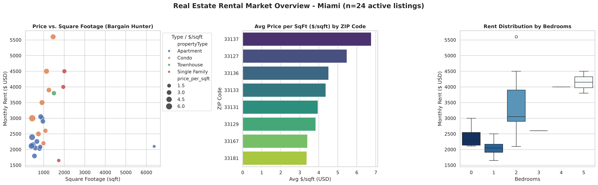

# Real Estate Rental ETL Pipeline

An end-to-end data pipeline that extracts live rental listings from the [RentCast API](https://www.rentcast.io/), cleans and enriches them with investment metrics, and delivers both an executive visual report (PNG) and an interactive analytics dashboard (Streamlit).

[](https://real-estate-rental-etl.streamlit.app/)

**[→ Live demo](https://real-estate-rental-etl.streamlit.app/)** — filter listings by rent, property type and spot the best $/sqft deals. No setup needed.



## What it does

- **Extract** — pulls active rental listings for any US city/state (defaults to Miami, FL) and caches the raw JSON locally to save API calls
- **Transform** — dedupes records, enforces types, drops incomplete/outlier rows, and derives valuation metrics: `price_per_sqft`, `area_m2`, `price_per_m2`
- **Load** — exports the clean dataset to CSV (Excel-ready, `utf-8-sig`) and JSON
- **Visualize** — generates a 300-dpi market snapshot and serves a filterable web dashboard

Medallion-style layering: raw payload lands in `data/raw/` (Bronze), cleaned data in `data/processed/` (Silver/Gold).

## Tech stack

Python 3.14 · pandas · httpx · python-dotenv · matplotlib · seaborn · Streamlit · pytest

## Project structure

```
├── main.py                 # pipeline orchestrator
├── dashboard.py            # Streamlit dashboard
├── src/
│   ├── config.py           # paths, env vars, constants
│   ├── extractors.py       # RentCast API client + local cache
│   ├── transformers.py     # cleaning + valuation metrics
│   ├── exporters.py        # CSV/JSON persistence
│   └── visualizers.py      # executive PNG report
├── tests/                  # pytest suite for the transform layer
├── data/
│   ├── raw/                # bronze layer (git-ignored: contains agent PII)
│   └── processed/          # clean_listings.csv / .json
└── reports/figures/        # generated charts
```

## Getting started

**1. Clone and set up the environment**

```bash
git clone https://github.com/JoNasgaBri/real-estate-rental-etl.git
cd real-estate-rental-etl
python3 -m venv venv
source venv/bin/activate
pip install -r requirements.txt
```

**2. Configure the API key**

```bash
cp .env.example .env
# edit .env and paste your key — get a free one at https://app.rentcast.io/app/api
```

**3. Run the pipeline**

```bash
python main.py
```

Sample output:

```
[HTTP] Success: 25 listings received.
[TRANSFORM] In: 25 | Kept: 24 | Dropped: 1
[EXPORT] CSV saved: data/processed/clean_listings.csv (24 rows)
[VISUALIZER] Report saved to: reports/figures/market_overview.png

MARKET INSIGHTS:
• Qualified listings: 24
• Median rent: $2,550.00/mo
• Avg price per sqft: $3.23/sqft
```

## Interactive dashboard

```bash
streamlit run dashboard.py
```

Filter by max rent and property type, track KPIs (median rent, avg $/sqft), and browse opportunities sorted by the lowest price per square foot.

> **No API key?** The repo ships `data/processed/clean_listings.csv`, so `python -m src.visualizers` and the dashboard work out of the box on the bundled sample data.

## Testing

```bash
pytest
```

Covers deduplication, null/outlier filtering, and the `$/sqft` → `m²` metric conversions.

## Caching behavior

The first API response is saved to `data/raw/sample_raw.json`. Subsequent runs reuse it — delete the file or pass `use_cache=False` to fetch fresh data (free plans are rate-limited, so cache-first is the default).

## Design notes

- **$ per sqft as the core metric** — it normalizes rent across different unit sizes, which is how investors actually compare deals
- **Bronze layer is immutable** — raw payloads are never transformed in place, so re-processing never costs another API call
- **Fail-fast validation** — listings without price or area are dropped early; a property you can't value adds no signal
- **PII stays local** — raw API responses contain listing-agent contacts and are git-ignored; only the anonymized clean dataset is committed
